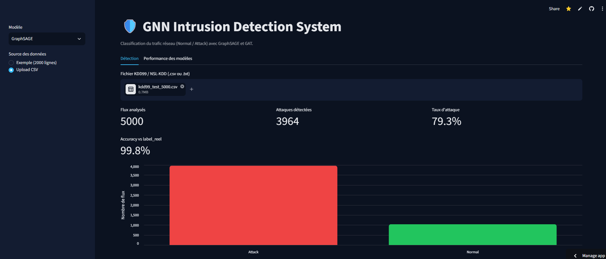

# GNN Intrusion Detection System (IDS)

[](https://github.com/Kellaikram/GNN-Intrusion-Detection/actions/workflows/ci.yml)
[](https://gnn-intrusion-detection-kwlymbfznwtctdbt7dbjmz.streamlit.app/)

Détection d'intrusions réseau avec des **Réseaux de Neurones sur Graphes (GNN)**. Le projet classe chaque flux réseau en **Normal** ou **Attack** et compare deux architectures : **GraphSAGE** et **GAT**.

**Démo en ligne : https://gnn-intrusion-detection-kwlymbfznwtctdbt7dbjmz.streamlit.app/**



## Fonctionnalités

- Chargement d'un fichier KDD99 / NSL-KDD (`.csv` ou `.txt`, avec ou sans en-tête) ou d'un échantillon de démonstration
- Prédiction Normal / Attack pour chaque flux, avec la probabilité d'attaque
- Choix du modèle (GraphSAGE ou GAT), métriques et graphique
- Si le fichier contient la vraie classe (`label_reel`), calcul de l'accuracy
- Export des résultats en CSV

## Dataset

- **KDD99** (entraînement et test) : 494 021 flux, 41 features, classification binaire (normal / attack)
- Test set : 74 104 exemples (14 493 normal, 59 611 attack)
- **NSL-KDD** (`KDDTest+`, 22 544 flux) : utilisé uniquement pour mesurer la généralisation

## Méthode

1. Encodage des 3 colonnes catégorielles (`protocol_type`, `service`, `flag`) avec `LabelEncoder`, puis standardisation avec `StandardScaler`.
2. Construction du graphe par **k plus proches voisins (k = 5)** : chaque flux est un nœud relié à ses 5 voisins les plus proches.
3. Classification de nœuds avec :
   - **GraphSAGE** : `SAGEConv(41 → 64)` → ReLU → Dropout → `SAGEConv(64 → 2)`
   - **GAT** : `GATConv(41 → 64, heads=2)` → ELU → `GATConv(128 → 2)`
4. Entraînement : 100 epochs, Adam (lr = 0,005, weight decay = 5e-4), CrossEntropyLoss, sur Google Colab.

## Résultats

Test set KDD99 (74 104 exemples) :

| Modèle | Accuracy |
|---|---|
| GAT | 99,71 % |
| GraphSAGE | 99,84 % |

Évaluation sur NSL-KDD `KDDTest+` (GraphSAGE, 22 544 flux) : **77,1 %** d'accuracy.

## Limites

- KDD99 date de 1999. Les 99,8 % obtenus sur son test set ne garantissent pas les mêmes performances sur du trafic actuel.
- Sur NSL-KDD, le modèle détecte moins d'attaques qu'il n'y en a : les attaques absentes de l'entraînement ne sont pas reconnues (changement de distribution).
- Le graphe de l'application est construit sur le fichier chargé (limité à 5 000 lignes), et non sur les 494 021 flux de l'entraînement.
- Le modèle attend les 41 features KDD99. Du trafic brut doit d'abord être transformé dans ce format.

## Lancer le projet

```bash
git clone https://github.com/Kellaikram/GNN-Intrusion-Detection.git
cd GNN-Intrusion-Detection
pip install -r requirements.txt
streamlit run app.py
```

Lancer les tests et le lint :

```bash
pytest
ruff check src tests
```

## Structure

```
├── app.py                  # dashboard Streamlit
├── src/models.py           # classes GraphSAGE et GAT
├── tests/                  # tests pytest
├── models/                 # poids (.pt), scaler et encoders (.joblib)
├── data/sample.csv         # échantillon de démonstration
├── notebooks/              # entraînement (Google Colab)
└── .github/workflows/ci.yml
```

## CI/CD

- **CI** : à chaque pull request, GitHub Actions installe les dépendances, lance `ruff` puis `pytest`. Un merge n'est fait que si les vérifications passent.
- **CD** : Streamlit Community Cloud est relié à la branche `main` et redéploie l'application à chaque merge.

## Technologies

Python, PyTorch, PyTorch Geometric, scikit-learn, pandas, Streamlit, pytest, ruff, GitHub Actions, Google Colab.
